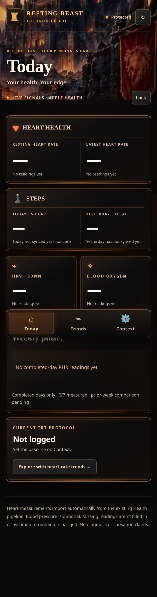
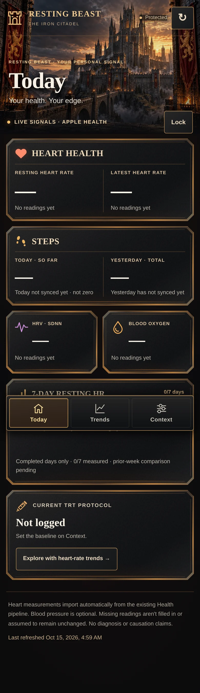

# Iron Citadel visual review

This branch is for visual approval. It has not been merged or deployed.

The supplied concept calls for realistic fortress scenery, crimson heraldry, warm firelight, and finely constructed dark metal panels. The supplied iPhone screenshots already had useful metric grouping, page placement, and a warm palette. Those were preserved. The 270×172 painting, accumulated style overrides, rounded double borders, inconsistent system glyphs, and excess footer spacing were the principal implementation gaps.

The active v7 stylesheet replaces the old layered stylesheet with one current visual layer. The live scripts, form constraints, canvas attributes, element IDs, page ownership, and CSP are unchanged. The small HTML changes provide decorative inline SVG icons, semantic card headings, descriptive refresh/close labels, and a compact weekly-chart heading. No health records or backend resources were accessed or changed during this work.

## Artwork

The original scenery was generated with the image tool already available in the session; no new service, account, credential, or external runtime request is required. Its native landscape export is 1536×1024. The deployed derivatives are local WebP files:

| Asset | Dimensions | Bytes | Selection |
| --- | --- | --- | --- |
| `iron-citadel-fortress-1536.webp` | 1536×1024 | 408692 | Single live scenery source at every viewport |
| `iron-citadel-fortress-768.webp` | 768×512 | 122984 | Retained derivative; not requested by the app |

At 430 CSS pixels the large asset provides 3.57 source pixels per CSS pixel; at 390 it provides 3.94. CSS preserves the complete composition and its aspect ratio, independently of phone height. It does not stretch or upscale a tiny source. Only one scenery asset is selected; a regression assertion checks the actual resource list. The images contain no labels, controls, charts, or health metrics. The steel grain is a separate, tiny local SVG texture.

There is no outstanding scenery-source blocker. The remaining visual differences are intentional limits for review: the scene fades beneath the cards rather than surrounding every panel with illustrated fire, the heraldry and architecture are original rather than an exact recreation, and the HTML panels use restrained metal bevels rather than the concept's intricate painted frames.

## Screenshots

These are Chromium desktop-emulation captures, not actual iPhone screenshots. All dashboard captures use an intercepted **empty** response: dashes and missing-data messages are intentional. There are no invented health readings, protocol entries, or saved records. The dialog's dose/interval placeholders are unchanged application placeholders. WebP review copies are reduced from the original PNG captures.

| Before, 390px | After, 390px |
| --- | --- |
|  |  |

- [Today, 430px](screenshots/after-today-430.webp)
- [Today at the final scroll position, footer clear of dock](screenshots/after-today-end-390.webp)
- [Trends and comparisons](screenshots/after-trends-390.webp)
- [Context](screenshots/after-context-390.webp)
- [Login](screenshots/after-login-390.webp)
- [Edit dialog](screenshots/after-dialog-390.webp)

## Verification

Final result: **all six Chromium viewport combinations passed**, including one scenery download per viewport, zero uncaught JavaScript errors, and zero unexpected external requests. Static checks and `git diff --check` passed. See [recorded results](results.json).

Run from the repository root with Python Pillow, Python Playwright, Node, and a Chromium binary available:

```sh
python3 pulse/tests/visual_review.py --chromium /usr/bin/chromium --output /tmp/iron-citadel-review
git diff --check
```

The suite checks unchanged functional source against baseline `de00cd26bef5e3169ffc1a0fcbb238959200eba8`, JavaScript syntax, DOM IDs, form constraints, script references, canvas attributes, CSP, image dimensions/encoding/budgets, and SVG integrity. Browser checks cover 320×568, 360×780, 390×844, 430×932, 768×1024, and 1440×900. They exercise all pages, typography width/wrapping probes, footer/dock clearance, all change-dialog types, medication form opening, local key checking, lock, intercepted error states, chart keyboard/mouse/range/native-touch handlers, swipe navigation, focus indication, reduced motion, console errors, and single-asset scenery loading. Every external request is intercepted; the suite cannot reach the actual health service.

Screenshots show the rendered empty-data UI. Brief typography probes test three-digit values, units, five-digit totals, and long timestamps, then restore the empty response before capture; these are never health response records or application defaults.

Limits: real iPhone Safari, Safari browser chrome and keyboard resizing, Home Screen safe-area values, actual Android devices, and WebKit were not verified. WebKit dependency work was stopped as requested. The existing safe-area expressions and scroll clearance were reviewed and emulated, but real-device acceptance remains necessary. No live authentication, write, populated history, or real-data chart session was performed. Script identity protects the existing data/calculation and logging contracts; empty-chart gesture tests do not establish real-device populated-chart behavior.

## Rollback

Before merge, close this PR and retain production unchanged. If later approved and merged, revert this reconstruction's commit (or its squash commit) to restore `index.html` and its v6 stylesheet reference. No database or history rollback is needed. Keep the corrected `app-iron-v10.js` pipeline; do not revert to the older resting-HR implementation.
